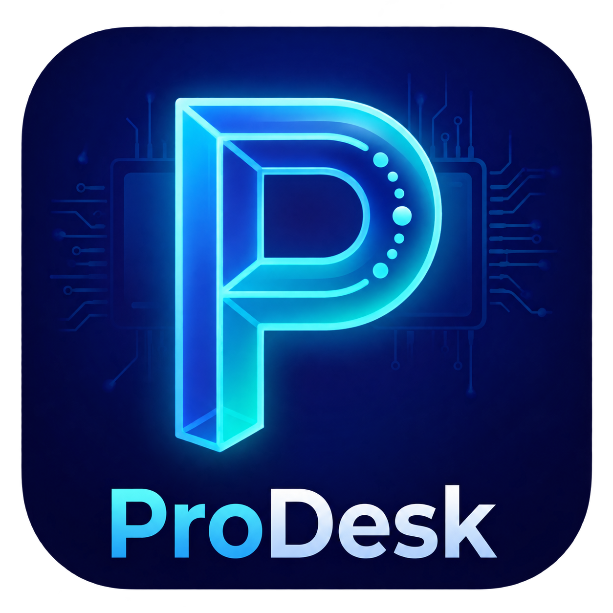

<div align="center">
  
  <h1>ProDesk</h1>
  <p><strong>Удалённый доступ · Windows x64 · ServerPro</strong></p>
  <p>На основе RustDesk · GNU AGPL-3.0</p>
  <p><a href="https://github.com/ServerProIT/ProDesk-Releases/releases/latest">Скачать последнюю версию</a></p>
</div>

ProDesk использует собственные серверы ServerPro и предлагает локальную
адресную книгу с деревом папок, цветами, сохранёнными подключениями и
импортом/экспортом JSON. Для адресной книги не нужна учётная запись RustDesk.

## Быстрое развёртывание

Запустите **64-разрядный PowerShell от имени администратора** на клиентском ПК:

```powershell
& { $p = Join-Path $env:TEMP ('ProDesk-' + [guid]::NewGuid().ToString('N') + '.ps1'); Invoke-WebRequest -UseBasicParsing 'https://github.com/ServerProIT/ProDesk-Releases/releases/latest/download/Deploy-ProDesk.ps1' -OutFile $p; & powershell.exe -NoProfile -ExecutionPolicy Bypass -File $p }
```

Программа скачивается, проверяется по SHA256, устанавливается и добавляется
в автозапуск. Служба запускается автоматически, затем открывается окно ProDesk
на текущем рабочем столе. Повторный запуск команды также открывает окно.
Выполняйте команду в интерактивном сеансе пользователя. Последующие проверки обновлений
выполняются при запуске программы/трея и после загрузки Windows; задача работает
от SYSTEM и не требует повторных запросов UAC. Во время обновления активные
сеансы могут перезапуститься.

[Подробнее об установке и обновлениях](docs/DEPLOYMENT.md) ·
[Адресная книга и перенос данных](docs/ADDRESS-BOOK.md)

## Файлы релиза

| Файл | Назначение |
|---|---|
| `ProDesk-<версия>-windows-x64.exe` | Переносимый запуск и установка через интерфейс |
| `ProDesk-<версия>-windows-x64.zip` | Пакет для автоматического развёртывания |
| `Deploy-ProDesk.ps1` | Установка и обновление |
| `ProDesk-<версия>-source.tar.gz` | Полные соответствующие исходники с подмодулем |
| `SHA256SUMS.txt` | Контрольные суммы |
| `LICENCE.txt`, `NOTICE.md` | Лицензия и уведомления |

EXE публикуется без Authenticode-подписи. При ручном скачивании возможен
SmartScreen. Установочный скрипт не отключает защиту Windows.

## Лицензия и исходники

ProDesk — независимая модификация [RustDesk](https://github.com/rustdesk/rustdesk),
распространяемая под GNU AGPL-3.0. Соответствующие исходники каждого выпуска
находятся в архиве `ProDesk-<версия>-source.tar.gz` того же релиза.
Передавайте получателям программы исходники и лицензию вместе с бинарником.
Оригинальные авторские уведомления сохранены. См. [LICENCE](LICENCE) и
[NOTICE.md](NOTICE.md).
